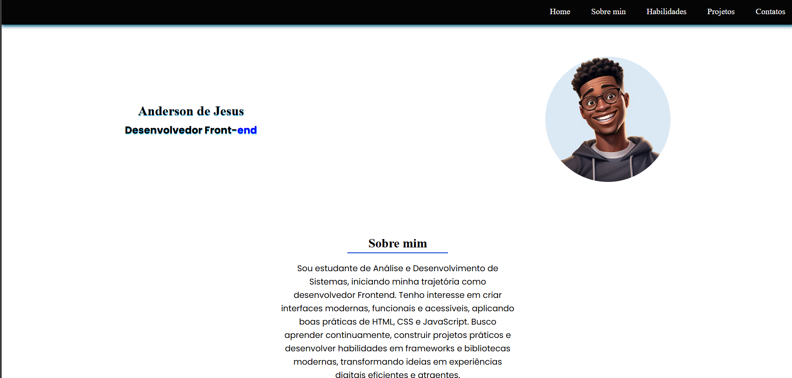

  <h1>🌐 Projeto da Faculdade</h1>
  
Landing page web desenvolvida com HTML e CSS como parte de um trabalho ou exercício de Frontend.

---

## 📌 Sobre o Projeto

O **Projeto da Faculdade** é uma página web estática construída com **HTML e CSS**, criada como parte de uma atividade acadêmica para aplicar fundamentos de desenvolvimento web.

Este projeto demonstra organização de layout, uso de semântica HTML e estilos visuais com CSS, simulando um pequeno site funcional que poderia ser usado para apresentar uma instituição, serviço ou conteúdo informativo.

---

## 📸 Preview da Aplicação

  

---

## 🎯 Objetivo do Projeto

O objetivo principal foi praticar e aplicar os fundamentos básicos de desenvolvimento web:

- Estruturação semântica com **HTML**
- Design visual com **CSS**
- Posicionamento e layout de elementos
- Organização de estilos e classes

---

## 🚀 Funcionalidades

- Página responsiva (adaptada para diferentes larguras)  
- Estrutura clara de navegação (se houver menu)  
- Conteúdo apresentado de forma organizada  
- Uso de ícones e estilos visuais  

*(Ajuste essa lista se o projeto tiver mais funcionalidades visuais ou seções específicas.)*

---

## 🛠️ Tecnologias Utilizadas

| Tecnologia | Aplicação no projeto |
|------------|----------------------|
|  **HTML5** | Estrutura semântica e organização do conteúdo |
|  **CSS3** | Layout, estilos e apresentação visual |

---

## 📈 Aprendizados e Evolução Técnica

Ao desenvolver este projeto, tive a oportunidade de:

- Organizar uma página web com estrutura semântica  
- Aplicar estilos CSS para visual mais agradável  
- Trabalhar conceitos de layout e posicionamento  
- Entender melhor a relação entre HTML e CSS  
- Preparar base para projetos web mais complexos  

---

⭐ Se este projeto chamou sua atenção, fique à vontade para explorar o código!

